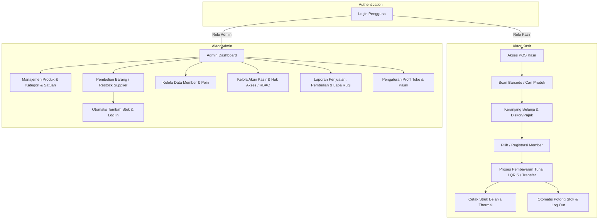
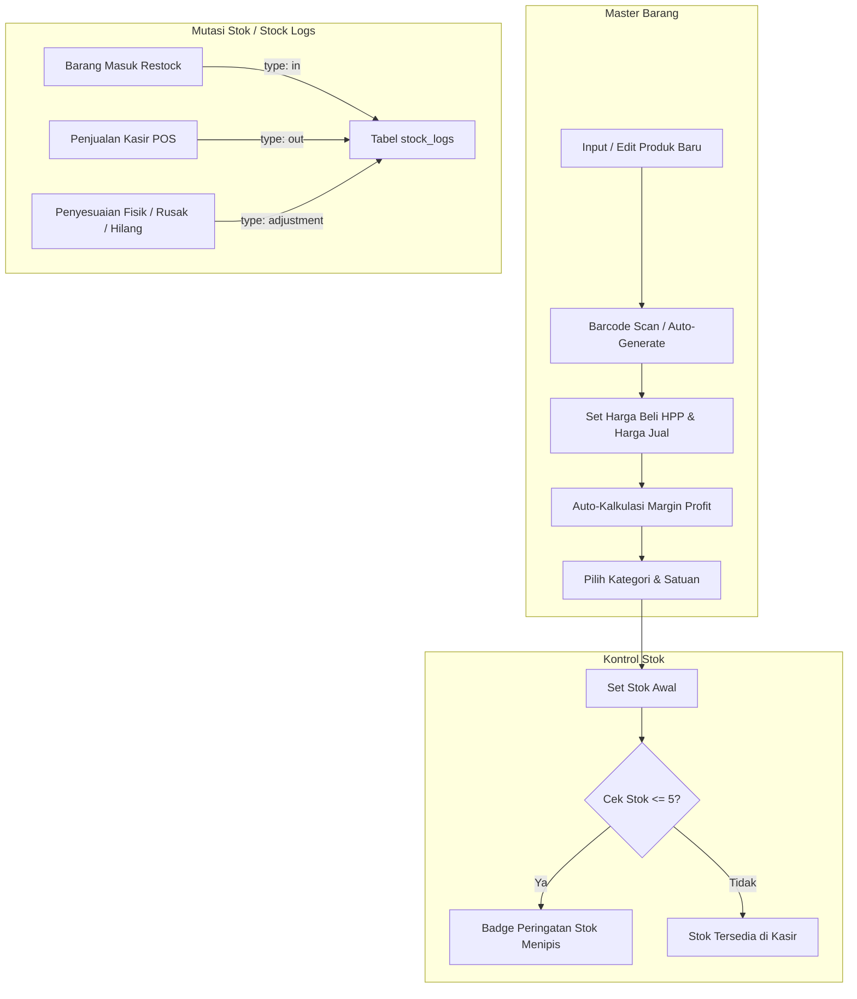
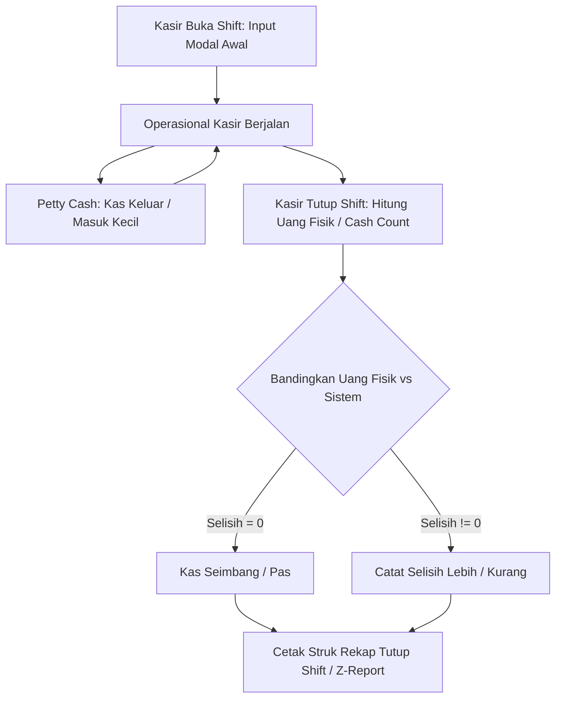
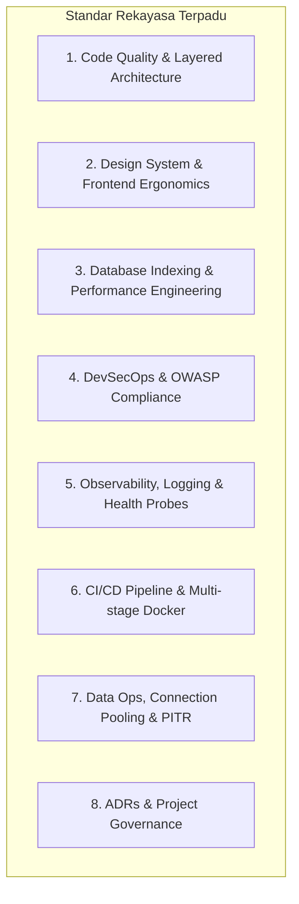

# BLUEPRINT & DOKUMEN IMPLEMENTASI
# SISTEM KASIR DIGITAL DAN PENCATATAN KEUANGAN (KASIRIN)

---

## 1. PENDAHULUAN & RINGKASAN SISTEM

### 1.1 Deskripsi Proyek
**Kasirin** adalah platform Kasir Digital (Point of Sale / POS) dan Pencatatan Keuangan terintegrasi berbasis web responsif modern. Sistem ini dirancang untuk mendigitalkan operasional kasir di toko/ritel, mengontrol persediaan barang (stok & restock), mencatat riwayat transaksi pelanggan dan member loyalty, serta menyajikan pembukuan dan analisis keuangan (omzet, HPP, dan laba rugi) secara *real-time*.

### 1.2 Tujuan Utama Sistem
1. **Kecepatan Transaksi Kasir**: Mempercepat checkout pelanggan dengan dukungan barcode scanner dan pencarian instan.
2. **Akurasi Stok & Mutasi**: Menjaga integritas inventaris melalui pencatatan mutasi stok otomatis (*stock logs*) baik saat barang masuk (pembelian/restock) maupun barang keluar (penjualan kasir).
3. **Pencatatan Keuangan Otomatis**: Menghubungkan transaksi penjualan dan pengeluaran pembelian barang ke dalam laporan keuangan laba-rugi tanpa perlu pembukuan manual ganda.
4. **Retensi Pelanggan**: Mendukung sistem membership dengan akumulasi poin belanja.
5. **Kontrol Hak Akses Ketat (RBAC)**: Memisahkan wewenang antara Admin (pengelola sistem & keuangan) dan Kasir (operator transaksi harian).

---

## 2. PEMODELAN CARA KERJA SISTEM (BUSINESS PROCESS & WORKFLOW)

Sesuai Use Case Diagram, sistem memiliki dua aktor utama: **Admin** dan **Kasir (Actor)**.



### 2.1 Alur Transaksi Kasir (POS Lifecycle)
1. **Inisiasi Transaksi**: Kasir login dan membuka antarmuka POS (`/kasir`).
2. **Input Produk**:
   - Kasir menembakkan barcode scanner pada kemasan barang ATAU mengetik nama produk di kolom pencarian cepat.
   - Item masuk ke daftar keranjang (*Cart*). Jika item sudah ada, kuantitas otomatis bertambah +1.
   - Sistem memvalidasi ketersediaan stok produk: kuantitas tidak boleh melebihi stok yang tersedia.
3. **Penetapan Pelanggan / Member**:
   - Jika pembeli memiliki kartu/nomor member: Kasir mencari berdasarkan nomor telepon/nama.
   - Jika pembeli ingin mendaftar baru: Kasir dapat langsung meregistrasikan member tanpa meninggalkan halaman POS.
   - Jika pembeli biasa: Kasir memilih opsi "Pelanggan Umum" (Non-Member).
4. **Kalkulasi Subtotal, Diskon & Pajak**:
   - Subtotal dihitung otomatis dari `Σ (harga_jual × qty)`.
   - Diskon per transaksi (persentase atau nominal rupiah) diterapkan.
   - Pajak (PPN toko sesuai `store_settings.tax`) dihitung otomatis berdasarkan subtotal setelah diskon.
   - Nilai akhir didapatkan pada **Grand Total**.
5. **Pembayaran & Validasi**:
   - Kasir memilih metode pembayaran: **Tunai (Cash)**, **QRIS**, atau **Transfer Bank**.
   - Untuk Tunai: Kasir memasukkan nominal uang yang diterima (disediakan shortcut uang pas: 10k, 20k, 50k, 100k). Sistem menghitung uang kembalian (*change amount*). Uang yang dibayar tidak boleh kurang dari Grand Total.
   - Untuk QRIS/Transfer: Sistem menampilkan QR Code / nomor rekening dan input referensi pembayaran.
6. **Finalisasi & Cetak Struk**:
   - Sistem menyimpan transaksi dan rincian transaksi ke database secara atomik (database transaction).
   - Stok produk berkurang otomatis dan tercatat pada tabel `stock_logs` dengan referensi `type: 'out'`.
   - Jika transaksi menyertakan member, poin bertambah sesuai rasio pembelanjaan toko.
   - Struk nota belanja otomatis terbuka untuk dicetak (format thermal 58mm/80mm) atau dikirim salinan digital.
   - Form kasir ter-reset otomatis untuk melayani pembeli berikutnya.

### 2.2 Alur Manajemen Barang & Kontrol Inventaris (Product & Stock Lifecycle)
Manajemen barang adalah fondasi utama dari sistem kasir dan keuangan. Seluruh pergerakan barang dimonitor secara ketat melalui siklus berikut:



1. **Master Katalog Produk**:
   - **Barcode / SKU**: Setiap barang memiliki kode unik. Kasir/Admin dapat menembakkan barcode dari kemasan atau men-generate kode otomatis.
   - **Kategori & Satuan**: Mengelompokkan barang (misal: Minuman, Makanan, Sembako) dan satuan jual (Pcs, Box, Kg, Botol, Pack) untuk akurasi data.
   - **Harga Beli (HPP) & Harga Jual**: Saat admin menginput harga beli dan harga jual, sistem otomatis menghitung margin keuntungan (nominal dan persentase markup) secara langsung di form input.
   - **Integritas Relasi**: Produk yang sudah memiliki riwayat penjualan atau pembelian dilindungi dari penghapusan sembarangan agar laporan keuangan masa lalu tidak korup.
2. **Kontrol Stok & Peringatan Stok Menipis (*Low Stock Alert*)**:
   - Sistem memantau kuantitas stok secara *real-time*.
   - Barang dengan sisa stok ≤ 5 unit otomatis diberi status/badge warna **Menipis (Warning)**, dan stok 0 diberi status **Habis (Danger)** pada tabel produk dan kasir POS.
   - Barang dengan stok 0 otomatis tidak dapat dijual di kasir (mencegah *negative stock*).
3. **Penyesuaian Stok Manual (*Stock Adjustment / Opname Stok*)**:
   - Digunakan saat terjadi selisih stok fisik di toko (misal: barang rusak, kemasan bocor, kedaluwarsa, barang hilang, atau koreksi hitung saat stok opname berkala).
   - Admin memilih produk, menentukan selisih kuantitas (+ atau -), dan memilih alasan penyesuaian.
   - Sistem langsung mengupdate stok produk dan mencatat log mutasi `type: 'adjustment'` lengkap dengan alasan dan user pelaksana.
4. **Riwayat Mutasi Stok Real-Time (`stock_logs`)**:
   - Buku besar pergerakan barang (*audit trail*) yang merekam setiap perubahan stok secara otomatis:
     - `in`: Barang bertambah karena pembelian dari supplier (*Restock*).
     - `out`: Barang berkurang karena transaksi penjualan kasir (*POS*).
     - `adjustment`: Barang disesuaikan secara manual (*Stock Opname*).
   - Data mencakup: Tanggal/Waktu, Nama Produk, Kuantitas, Stok Sebelum, Stok Sesudah, Referensi (No Invoice Transaksi / Faktur Beli), Keterangan, dan Kasir/Admin yang bertugas.
5. **Cetak Label Barcode & Price Tag**:
   - Kemampuan men-generate visual barcode (Code128) dan mencetak label harga untuk ditempelkan pada rak etalase toko atau kemasan produk UMKM yang belum memiliki barcode pabrikan.

---

### 2.3 Alur Pembelian Barang / Restock (Purchases Lifecycle)
1. **Pilih Supplier**: Admin membuka menu Restock (`/admin/purchases`) dan memilih supplier terdaftar (atau tambah supplier baru).
2. **Input Nomor Faktur**: Admin menginput nomor faktur/surat jalan dari pemasok dan tanggal pembelian.
3. **Pilih Produk & Harga Beli**: Admin memilih produk yang dibeli, memasukkan kuantitas masuk, dan harga beli per unit (jika harga beli berubah dari supplier, sistem dapat memperbarui HPP produk).
4. **Simpan Restock**:
   - Total pembelian dihitung dan disimpan di tabel `purchases` dan `purchase_details`.
   - Stok produk pada tabel `products` bertambah otomatis.
   - Entri baru dicatat pada tabel `stock_logs` (`type: 'in'`, `reference_type: 'purchase'`, `stock_before`, `stock_after`).
   - Nilai pembelian masuk ke pos pencatatan pengeluaran barang masuk dalam laporan keuangan.

---

### 2.4 Alur Sistem Loyalitas Member
1. **Pendaftaran**: Kasir atau Admin mendaftarkan member dengan data: Nama, Nomor Telepon, Alamat.
2. **Akumulasi Poin**: Setiap transaksi kasir yang mengaitkan ID member akan mendapatkan poin, misalnya 1 poin setiap kelipatan Rp 10.000 belanja.
3. **Histori Member**: Admin dan Kasir dapat melihat riwayat transaksi dan saldo poin yang dimiliki setiap member.

---

### 2.5 Alur Pencatatan Keuangan & Laporan
Sistem mengonsolidasikan data secara otomatis dari penjualan dan pembelian:
1. **Laporan Penjualan (Omzet)**:
   - Total pendapatan kotor, total diskon, total pajak terkumpul, dan pendapatan bersih.
   - Filter berdasarkan rentang tanggal (Harian, Mingguan, Bulanan, Custom).
   - Rincian per metode pembayaran (Cash vs QRIS vs Transfer) untuk memudahkan *cash audit* (rekonsiliasi uang fisik kasir).
2. **Laporan Pembelian & Beban Barang**:
   - Total modal yang dikeluarkan untuk restock per supplier dan per periode.
3. **Laporan Laba Rugi Sederhana**:
   - **Pendapatan Bersih Penjualan**: Grand Total penjualan dikurangi PPN.
   - **Harga Pokok Penjualan (HPP)**: `Σ (purchase_price × qty_terjual)`.
   - **Laba Kotor (Gross Profit)**: Pendapatan Bersih - HPP.
4. **Laporan Stok & Mutasi**:
   - Pergerakan barang cepat laku (*fast-moving*), barang hampir habis (*low stock alert*), dan riwayat penyesuaian stok (*stock adjustment*).

---

## 3. PEMETAAN USE CASE & ROLE-BASED ACCESS CONTROL (RBAC)

Berdasarkan gambar Use Case Diagram yang diberikan:

| Aktor | Use Case Diagram | Fitur / Route Aplikasi | Wewenang & Batasan |
|---|---|---|---|
| **Kasir & Admin** | `login` | `/signin` & `/api/auth` | Autentikasi menggunakan session cookie terenkripsi |
| **Admin** | `manajemen: menu / produk` | `/admin/products`, `/categories`, `/units`, `/stock-logs` | Master data katalog barang, harga beli (HPP), harga jual, margin laba, kategori, satuan, dan riwayat stok |
| **Kasir** | `scan barcode/cari produk` | `/kasir` (Search bar & Barcode listener) | Pencarian instan produk berdasarkan nama, kode/barcode |
| **Kasir** | `membuat transaksi` | `/kasir` (Checkout & Cart) | Memilih item, edit kuantitas, simpan transaksi |
| **Kasir** | `proses pembayaran` | `/kasir` (Payment Modal) | Pembayaran Cash, QRIS, Transfer; hitung kembalian |
| **Kasir** | `cetak struk` | Modal cetak struk (Thermal 58/80mm) | Mencetak struk fisik via `window.print()` / driver thermal |
| **Kasir** | `hitung diskon/pajak/total` | Engine kalkulasi keranjang POS | Kalkulasi real-time diskon toko, PPN, dan grand total |
| **Kasir** | `kelola member` & `registrasi member` | Modal popup member di halaman `/kasir` | Pencarian member & pembuatan member baru instan |
| **Admin** | `manajemen: user` & `kelola: user` | `/admin/rbac/users` | Tambah kasir, ganti password, atur status aktif/non-aktif |
| **Admin** | `manajemen: menu` | `/admin/rbac/menus` & `/admin/rbac/roles` | Manajemen struktur menu & hak akses dinamis (RBAC) |
| **Admin** | `manajemen: customer` & `kelola: member` | `/admin/members` | Kelola master data member, alamat, kontak, & poin |
| **Admin** | `manajemen: pembelian barang` | `/admin/purchases` & `/admin/suppliers` | Input restock faktur barang masuk, kelola supplier |
| **Admin** | `manajemen: laporan` | `/admin/reports` (Penjualan, Keuangan, Stok) | Akses laporan omzet, rekap kasir, laba kotor & ekspor |
| **Admin** | Pengaturan Toko | `/admin/settings` | Nama toko, logo, alamat nota struk, persentase pajak |

---

## 4. SYSTEM ARCHITECTURE & TECHNICAL DESIGN

### 4.1 Tech Stack
- **Framework**: Next.js 16 (App Router) + React 19 + TypeScript.
- **Styling**: Tailwind CSS v4 + TailAdmin Design System (Responsif, tema Dark/Light modern, komponen modal & table terpadu).
- **Database & ORM**: MySQL + Drizzle ORM (`drizzle-orm/mysql2`).
- **Autentikasi**: JWT Session terenkripsi berbasis HTTP-only cookies (`jose`, `bcryptjs`).
- **Runtime & Tools**: Bun / Node.js, `tsx` untuk seeding & migration.
- **Visualisasi & Ikon**: Lucide React, ApexCharts (analisis grafik penjualan).

### 4.2 Struktur Folder Proyek
```text
src/
├── actions/                  # Server Actions (Mutasi DB & Keamanan)
│   ├── auth.ts              # Login & logout
│   ├── rbac.ts              # Menus, roles, users, permissions
│   ├── product.ts           # Produk, opname stok, mutasi stok
│   ├── category.ts          # Kategori produk
│   ├── unit.ts              # Satuan produk
│   ├── member.ts            # CRUD member & poin (Akan Dibuat)
│   ├── supplier.ts          # CRUD supplier restock (Akan Dibuat)
│   ├── purchase.ts          # Transaksi pembelian restock (Akan Dibuat)
│   ├── transaction.ts       # Transaksi POS Kasir (Akan Dibuat)
│   ├── report.ts            # Agregasi data laporan keuangan (Akan Dibuat)
│   └── setting.ts           # Pengaturan toko & struk (Akan Dibuat)
├── app/
│   ├── (admin)/admin/       # Layout Admin Dashboard
│   │   ├── dashboard/       # Ringkasan analitik & metrik
│   │   ├── products/        # Katalog produk, kategori, satuan, log stok
│   │   ├── purchases/       # Pembelian & restock dari supplier (Akan Dibuat)
│   │   ├── suppliers/       # Master data supplier (Akan Dibuat)
│   │   ├── members/         # Master data member/customer (Akan Dibuat)
│   │   ├── transactions/    # Riwayat transaksi penjualan (Akan Dibuat)
│   │   ├── reports/         # Laporan keuangan & laba rugi (Akan Dibuat)
│   │   ├── settings/        # Pengaturan toko (Akan Dibuat)
│   │   └── rbac/            # User & permission management
│   ├── (kasir)/kasir/       # Layout Khusus Antarmuka POS Kasir Fullscreen (Akan Dibuat)
│   │   ├── page.tsx         # Layar POS Kasir
│   │   └── _components/     # Cart, Search, BarcodeListener, PaymentModal, ReceiptModal
│   └── (full-width-pages)/  # Halaman Auth (signin, error-404)
├── db/
│   ├── index.ts             # Koneksi Drizzle DB
│   ├── schema.ts            # Definisi Tabel MySQL
│   └── seed.ts              # Inisialisasi Data Master
├── layout/                  # Sidebar, Header, User Menu
└── lib/                     # Auth helpers, formatting (Rupiah, Date), receipt generators
```

---

## 5. ANALISIS & OPTIMASI DATABASE SCHEMA

Dari evaluasi terhadap `src/db/schema.ts` saat ini, ditemukan beberapa kebutuhan penyesuaian agar selaras dengan Use Case:

### 5.1 Keputusan Desain & Perubahan Schema Terkonfirmasi:
1. **Tabel `transactions`**:
   - **`member_id`**: Diubah menjadi `int()` (nullable / opsional) agar pelanggan umum (non-member) dapat bertransaksi langsung tanpa hambatan.
   - **`user_id`**: Ditambahkan kolom `user_id: int().notNull()` dengan foreign key ke `users.id` agar setiap transaksi dapat diaudit dan dapat ditarik laporan rekap performa per-kasir.
2. **Tabel `members`**:
   - Memiliki `nama`, `phone`, `address`, `poin`. Siap digunakan untuk use case "kelola member" dan "registrasi member" langsung dari kasir.
3. **Tabel `purchases` & `purchase_details`**:
   - Memiliki `supplier_id`, `invoice`, `purchase_date`, `total`, `user_id`. Menjadi sumber data utama Harga Pokok Penjualan (HPP) dan mutasi stok barang masuk.
4. **Tabel `store_settings`**:
   - Berisi `store_name`, `address`, `email`, `logo`, `tax`. Digunakan untuk perhitungan PPN otomatis dan informasi kop struk nota kasir.
5. **Dukungan Format Struk**:
   - Disediakan toggle/opsi format 58mm (mini/portable thermal) dan 80mm (standar thermal printer ritel).
6. **Cakupan Laporan Keuangan**:
   - Difokuskan pada Laba Kotor (*Gross Profit* = Total Penjualan Bersih dikurangi HPP Restock Pembelian), rekap metode pembayaran (Cash/QRIS/Transfer), dan rekap kasir.

---

## 6. MEKANISME KEAMANAN, AUTENTIKASI & INTEGRITAS SISTEM (SECURITY & SYSTEM RESILIENCE)

Untuk menjamin keandalan data transaksi keuangan, mencegah manipulasi stok, dan menjaga privasi data pelanggan, sistem menerapkan standar keamanan dan ketahanan operasional berlapis (*defense-in-depth*):

```mermaid
flowchart TD
    subgraph Keamanan Berlapis (Defense-in-Depth)
        Req[Permintaan Request Pengguna] --> L1[Level 1: Middleware & Session Cookie Validasi]
        L1 --> L2[Level 2: Route Guard Berbasis Hak Akses RBAC]
        L2 --> L3[Level 3: Server Action Permission & Input Sanitasi]
        L3 --> L4[Level 4: Atomic Database Transaction / ACID]
        L4 --> DB[(Database MySQL)]
    end
```

### 6.1 Arsitektur Autentikasi & Manajemen Sesi
1. **Enkripsi Token Sesi (JWT via Jose)**:
   - Sesi dienkripsi menggunakan algoritma `HS256` dengan kunci rahasia server (`JWT_SECRET`).
   - Token disimpan dalam cookie bernama `session` dengan atribut:
     - `httpOnly: true`: Mencegah token dibaca oleh script browser jahat (proteksi mutlak dari serangan *XSS*).
     - `secure: true`: Hanya dikirim melalui koneksi HTTPS pada lingkungan produksi.
     - `sameSite: "lax"`: Melindungi dari serangan *Cross-Site Request Forgery (CSRF)*.
     - `expires`: Masa berlaku sesi aktif 24 jam dengan pembaruan otomatis (*sliding window*).
2. **Role-Based Smart Redirect saat Login**:
   - Sistem mendeteksi kode role saat proses autentikasi berhasil:
     - Jika role kasir (`KSR`): Langsung diarahkan ke layar transaksi kasir (`/kasir`).
     - Jika role admin (`ADM`): Diarahkan ke dashboard utama manajemen (`/admin/dashboard`).
3. **Pemeriksaan Status Akun Aktif (*Account Revocation Check*)**:
   - Jika admin menonaktifkan kasir (`is_active = false`), sesi pengguna tersebut otomatis tertolak pada request berikutnya tanpa perlu menunggu token expired.
4. **Keamanan Kata Sandi**:
   - Seluruh kata sandi di-hash menggunakan algoritma **Bcrypt** dengan *salt rounds* = 10. Kata sandi tidak pernah disimpan dalam bentuk teks polos (*plaintext*) dan tidak pernah dikembalikan ke sisi klien.

### 6.2 Mekanisme Otorisasi & Hak Akses Berlapis (RBAC Defense-in-Depth)
Sistem tidak hanya membatasi menu secara visual di sidebar, melainkan memverifikasi wewenang di 3 lapis:
1. **Lapis 1 (UI / Sidebar Filtering)**:
   - Fungsi `getSidebarMenus()` hanya mengambil dan merender daftar menu yang memiliki wewenang `can_read = true` sesuai role pengguna.
2. **Lapis 2 (Server Component & Layout Route Guard)**:
   - Di dalam layout dashboard (`src/app/(admin)/layout.tsx`), sistem memeriksa kecocokan URL aktif dengan tabel `role_permissions`.
   - Jika pengguna dengan role Kasir mencoba mengetik URL admin secara manual (misal: `/admin/rbac` atau `/admin/reports`), sistem langsung menolak dan me-redirect ke halaman akses ditolak (`/403` atau `/kasir`).
3. **Lapis 3 (Server Action Guarding)**:
   - Setiap Server Action yang melakukan perubahan data sensitif (seperti `deleteProduct`, `updateUser`, `saveRolePermissions`, `adjustStock`) wajib memanggil fungsi verifikasi sesi:
     ```ts
     const session = await getSession();
     if (!session || session.roleCode !== "ADM") {
       throw new Error("Akses ditolak: Anda tidak memiliki wewenang.");
     }
     ```

### 6.3 Integritas Transaksi Database & ACID (Atomic Operations)
Operasi kasir POS dan restock melibatkan banyak tabel sekaligus. Sistem menjamin kepatuhan **ACID** menggunakan transaksi database atomik (`db.transaction`):
1. **Atomic Checkout Kasir**:
   - Saat kasir menekan tombol "Bayar", sistem mengeksekusi operasi berikut dalam **1 kesatuan transaksi database**:
     1. Validasi ketersediaan stok fisik di database.
     2. Simpan header transaksi ke tabel `transactions`.
     3. Simpan rincian item ke tabel `transaction_details`.
     4. Kurangi stok produk di tabel `products` secara atomik.
     5. Buat entri mutasi stok keluar di tabel `stock_logs` (`type: 'out'`).
     6. Tambahkan poin belanja ke tabel `members` (jika pelanggan adalah member).
   - **Rollback Otomatis**: Jika salah satu langkah di atas gagal (misal: koneksi terputus atau stok ternyata sudah dibeli kasir lain), seluruh perubahan dibatalkan seketika. Tidak akan pernah terjadi kondisi uang tercatat namun stok tidak berkurang, atau stok berkurang namun struk transaksi gagal terbit.
2. **Pencegahan Kondisi Balapan (*Race Condition & Double Spending*)**:
   - Pengurangan stok menggunakan query kondisional berbasis database:
     `UPDATE products SET stock = stock - ? WHERE id = ? AND stock >= ?`
   - Hal ini memastikan dua kasir yang menjual barang terakhir pada detik yang sama tidak akan menyebabkan stok menjadi minus (*negative stock prevention*).

### 6.4 Validasi Data & Sanitasi Input
1. **Standarisasi Format Respons Server Action**:
   - Seluruh mutasi backend mengembalikan skema respons terpadu:
     ```ts
     type ActionResponse<T = any> = {
       success: boolean;
       message: string;
       data?: T;
       errors?: Record<string, string>;
     };
     ```
2. **Validasi Nilai Bisnis Ketat**:
   - Nilai harga jual, harga beli, dan kuantitas divalidasi `≥ 0`.
   - Jumlah uang bayar tunai diverifikasi `≥ grand_total` sebelum transaksi diterima.
   - Nilai diskon dibatasi `0 <= diskon <= subtotal`.
3. **Proteksi Injeksi SQL & XSS**:
   - Drizzle ORM menggunakan *Prepared Statements* berparameter secara bawaan, sehingga input pengguna tidak pernah digabungkan (*concatenated*) secara mentah ke dalam klausa SQL.
   - React 19 meng-escape semua output string secara otomatis untuk menangkal injeksi skrip (*Cross-Site Scripting*).

### 6.5 Pencegahan Fraud & Audit Finansial (Financial Integrity)
1. **Catatan Penjualan Tak Terubah (*Immutable Sales Records*)**:
   - Transaksi yang sudah dibayar (*status: 'paid'*) tidak dapat diedit atau dihapus sembarangan oleh kasir.
   - Jika terjadi salah input atau pembatalan (*void*), pembatalan hanya dapat disetujui oleh akun Admin/Supervisor dan dicatat sebagai transaksi baru bertipe pembatalan (mengembalikan stok ke `stock_logs` dengan alasan tertulis).
2. **Perekaman Jejak Kasir (*Cashier Audit Trail*)**:
   - Kolom `user_id` pada setiap faktur pembelian, transaksi penjualan, dan mutasi stok memastikan toko dapat merekonstruksi kronologi: siapa kasir yang melayani, pada jam berapa, dan berapa uang fisik yang seharusnya ada di laci kasir saat tutup shift.

### 6.6 Resiliensi Sistem & Hardware Failover
1. **Ketahanan Keranjang Belanja (*Cart Recovery*)**:
   - Item di keranjang kasir disimpan sementara pada *local storage* klien. Jika browser kasir tidak sengaja tertutup atau halaman ter-refresh, daftar barang belanjaan tidak hilang.
2. **Pencetakan Ulang Struk (*Reprint Receipt*)**:
   - Jika printer kasir kehabisan kertas atau mati lampu saat struk sedang mencetak, kasir dapat mencetak ulang struk kapan saja melalui riwayat transaksi terakhir.
3. **Pencarian Manual Saat Scanner Rusak**:
   - Jika barcode scanner mengalami gangguan fisik atau kemasan barang kotor/robek, kasir tetap dapat mencari barang instan melalui ketikan nama atau memilih langsung dari katalog visual.

---

---

## 7. MANAJEMEN SHIFT KASIR & REKONSILIASI KAS (CASH DRAWER & Z-REPORT)

Salah satu celah terbesar dalam operasional toko fisik adalah kehilangan atau selisih uang tunai di laci kasir. Sistem profesional mewajibkan siklus shift kasir terintegrasi:



### 7.1 Alur Kerja Shift Kasir:
1. **Buka Shift (*Starting Cash*)**:
   - Saat kasir login dan hendak menggunakan POS, sistem meminta kasir menginput **Modal Kas Awal** di laci (misal: Rp 200.000 untuk uang kembalian).
   - Kasir tidak dapat memproses transaksi penjualan sebelum membuka shift.
2. **Pencatatan Kas Darurat (*Petty Cash*)**:
   - Jika toko memerlukan uang tunai darurat dari laci (misal: beli plastik kresek, air minum, atau uang galon), kasir menginput *Cash Out* beserta alasan.
   - Jika pemilik toko menambah uang kembalian di tengah hari, kasir menginput *Cash In*.
3. **Tutup Shift (*End Shift / Closing Register*)**:
   - Saat pergantian kasir atau toko tutup, kasir melakukan *Cash Count* (menghitung uang fisik pecahan kertas dan koin di laci).
   - Sistem secara otomatis menghitung:
     $$\text{Uang Diharapkan} = \text{Modal Awal} + \text{Penjualan Tunai} + \text{Kas Masuk} - \text{Kas Keluar}$$
   - Sistem menghitung selisih:
     $$\text{Selisih} = \text{Uang Fisik Aktual} - \text{Uang Diharapkan}$$
   - Data selisih dicatat permanen dalam riwayat shift untuk audit pemilik toko (*Zero Fraud Tolerance*).
4. **Cetak Rekap Shift (*Z-Report Printout*)**:
   - Struk thermal ringkasan shift dicetak berisi: Nama Kasir, Jam Mulai & Selesai, Modal Awal, Total Penjualan Tunai, Total Penjualan QRIS/Transfer, Total Transaksi, Kas Keluar, Uang Fisik, dan Status Selisih.

---

## 8. ERGONOMI KECEPATAN KASIR: KEYBOARD-FIRST WORKFLOW & SHORTCUTS

Untuk mencegah antrean panjang, antarmuka kasir dirancang tanpa kewajiban menggunakan mouse. Seluruh alur POS dapat dijalankan dengan hotkeys keyboard standar:

| Tombol Shortcut | Aksi Sistem | Keterangan Operasional |
|---|---|---|
| `F1` | **Bantuan Shortcut** | Menampilkan panduan tombol pintas di layar |
| `F2` | **Fokus Cari Produk** | Kursor langsung aktif di kolom cari barang / scan |
| `F3` | **Pilih / Tambah Member** | Buka pop-up pencarian dan pendaftaran member |
| `F4` | **Input Diskon** | Buka input diskon transaksi (Rp atau %) |
| `Space` / `F8` | **Buka Pembayaran** | Membuka modal pembayaran checkout |
| `1` / `2` / `3` | **Pilih Metode Bayar** | Shortcut saat modal bayar terbuka (1: Tunai, 2: QRIS, 3: Transfer) |
| `Enter` | **Finalisasi & Cetak** | Simpan transaksi dan langsung cetak struk nota |
| `Esc` | **Batal / Tutup** | Menutup modal aktif / membatalkan input |
| `+` / `-` | **Atur Qty Item** | Menambah atau mengurangi jumlah barang aktif di keranjang |
| `Delete` | **Hapus Item** | Menghapus baris produk dari keranjang belanja |

---

## 9. MESIN PROMOSI, DISKON, POIN & PEMBULATAN RUPIAH

### 9.1 Diskon Fleksibel
- **Diskon Per Item**: Potongan harga untuk barang tertentu (misal: diskon promo produk Rp 2.000/pcs).
- **Diskon Transaksi Global**: Potongan harga pada total belanja (bisa berupa nominal langsung atau persentase, misal diskon 10%).

### 9.2 Sistem Loyalitas & Penukaran Poin (*Loyalty Redemption*)
- **Perolehan Poin**: Transaksi member otomatis menambah saldo poin (misal 1 poin setiap belanja Rp 10.000).
- **Penukaran Poin (*Redeem Points*)**: Saat checkout, kasir dapat memasukkan poin yang ingin ditukarkan member sebagai potongan tunai (misal: 50 poin = potongan belanja Rp 5.000).

### 9.3 Aturan Pembulatan Pembayaran Tunai (*Cash Rounding Rule*)
- Untuk transaksi tunai, sistem menyediakan kalkulasi pembulatan ke ratusan terdekat (misal: Rp 14.340 dibulatkan menjadi Rp 14.300 atau Rp 14.400) agar mempermudah kasir menyediakan uang kembalian fisik tanpa kebingungan uang koin receh.

---

## 10. SISTEM PEMBATALAN (VOID) & RETUR / REFUND BARANG

### 10.1 Pembatalan Transaksi (*Void*)
- Pembatalan transaksi yang sudah selesai membutuhkan otorisasi akun Supervisor/Admin (input PIN/Password).
- Transaksi yang di-void akan berubah status menjadi `cancelled`.
- Sistem otomatis mengembalikan stok barang yang dibatalkan ke tabel `products` dan mencatat entri pemulihan pada `stock_logs` (`type: 'in'`, referensi: "Void Transaksi #INV-xxx").

### 10.2 Retur Barang & Pengembalian Dana (*Return & Refund*)
- Pelanggan yang mengembalikan barang rusak atau salah beli dilayani melalui modul Retur.
- Kasir memasukkan nomor invoice asli, memilih barang yang diretur, dan menentukan kondisi:
  - **Barang Masih Baik**: Stok dikembalikan ke persediaan siap jual.
  - **Barang Rusak / Cacat**: Stok dialihkan ke catatan barang rusak (tidak dijual kembali).
- Uang yang dikembalikan dicatat sebagai pengeluaran kas retur pada pembukuan keuangan.

---

## 11. INTEGRASI PERANGKAT KERAS (HARDWARE INTEGRATION)

### 11.1 Barcode Scanner
- Scanner barcode USB/Bluetooth bekerja sebagai *Keyboard Wedge* (mengirim serangkaian keystroke disusul tombol `Enter`).
- Pada layar POS Kasir, sistem mengimplementasikan **Global Keypress Listener** atau auto-focused barcode input. Ketika scanner menembakkan kode, sistem mendeteksi input, mencocokkan kode ke `products.barcode`, lalu langsung menambahkan item ke keranjang belanja dengan feedback suara (*beep*).

### 11.2 Printer Thermal Struk (58mm & 80mm)
- Menggunakan CSS `@media print` dengan lebar kertas spesifik (`58mm` atau `80mm`) dan styling monokrom kontras tinggi.
- Menggunakan perintah browser `window.print()` yang langsung memicu pencetakan struk tanpa margin halaman browser (header/footer URL dimatikan lewat CSS `@page { margin: 0; }`).
- Komponen struk memuat:
  - Header: Nama toko, alamat, no. telp (dari `store_settings`).
  - Info: No. Invoice, Tanggal/Waktu, Nama Kasir, Nama Member (jika ada).
  - Tabel: Nama item, Qty, Harga Satuan, Subtotal.
  - Ringkasan: Subtotal, Diskon, Poin Ditukar, Pajak (PPN), Grand Total.
  - Pembayaran: Metode Bayar, Jumlah Bayar, Kembalian, Poin yang didapat.
  - Footer: Ucapan terima kasih & barcode invoice.

---

## 12. STRATEGI PENGUJIAN MUTU & PENJAMINAN KUALITAS (TESTING & QA)

Aplikasi finansial dan kasir menuntut ketepatan matematis 100%. Rencana pengujian mencakup:
1. **Unit Testing Formula Finansial**:
   - Verifikasi ketepatan matematis: `Subtotal - Diskon + PPN = Grand Total`.
   - Verifikasi uang kembalian: `Uang Bayar - Grand Total = Kembalian`.
   - Verifikasi perhitungan HPP dan Laba Kotor: `Pendapatan Bersih - Total HPP = Laba Kotor`.
2. **Pengujian Konkurensi & *Negative Stock Prevention***:
   - Simulasi 2 request transaksi serentak pada produk dengan stok tersisa 1 unit untuk memastikan salah satu transaksi ditolak dengan aman dan stok tidak menjadi `-1`.
3. **Pengujian Rollback Transaksi Atomik**:
   - Uji kegagalan sengaja di tengah transaksi database untuk memastikan data tidak pernah *corrupt* atau menggantung separuh jalan.

---

## 13. PENCADANGAN DATA, PEMULIHAN BENCANA, & DEPLOYMENT

### 13.1 Pencadangan Data & Ekspor Mandiri (*Backup & Portability*)
- Fitur ekspor seluruh data master (Produk, Member, Supplier) dan laporan transaksi ke format **Excel (.xlsx)**, **CSV**, dan **PDF**.
- Skrip cadangan basis data otomatis (*Daily Automated MySQL Dump*) untuk mengamankan data transaksi dari risiko kerusakan perangkat keras komputer toko.

### 13.2 Kontainerisasi & Standarisasi Lingkungan
- Penyediaan `Dockerfile` dan `docker-compose.yml` untuk menjalankan sistem terisolasi lengkap dengan MySQL dalam 1 perintah (`docker compose up -d`).
- File `.env.example` terdokumentasi rapi untuk memudahkan konfigurasi di mesin produksi atau server lokal toko.

### 13.3 Standar Operasional Prosedur (*SOP Kasir & Admin*)
- Panduan tertulis ringkas untuk kasir:
  1. Cara buka kasir & input modal awal.
  2. Cara melayani transaksi & scan barcode.
  3. Cara menangani printer macet & reprint nota.
  4. Cara tutup kasir & serah terima shift (Z-Report).

---

---

## 14. STANDAR REKAYASA SISTEM MODERN (ENGINEERING EXCELLENCE & NON-FUNCTIONAL ARCHITECTURE)

Sebuah aplikasi profesional kelas industri (*enterprise-grade*) tidak hanya dinilai dari fiturnya, melainkan dari **kualitas rekayasa perangkat lunak (*software craftsmanship*), keandalan, skalabilitas, dan kemudahan pemeliharaan**.



### 14.1 Arsitektur Berlapis Bersih (*Clean Layered Architecture*) & Type-Safety
1. **Pemisahan Tanggung Jawab (*Separation of Concerns*)**:
   - **UI Component Layer (`src/app/` & `src/components/`)**: Hanya bertanggung jawab atas rendering tampilan dan interaksi pengguna.
   - **Server Action / Controller Layer (`src/actions/`)**: Memvalidasi request, mengecek sesi & izin RBAC, memanggil service layer, dan memicu revalidasi cache.
   - **Service / Domain Logic Layer (`src/services/`)**: Berisi aturan bisnis murni (kalkulasi pajak, diskon bertingkat, formulasi HPP, pemotongan stok, logika penutupan shift) yang bebas dari ketergantungan framework.
   - **Data Access / Repository Layer (`src/db/`)**: Query database terisolasi menggunakan Drizzle ORM.
2. **Strict TypeScript & Zero `any` Policy**:
   - Mengaktifkan `strict: true` di `tsconfig.json`.
   - Menggunakan tipe domain kuat (*Strongly Typed Entities*) untuk transaksi, mutasi stok, dan item keranjang.
3. **Validasi Skema Request (Zod Engine)**:
   - Setiap data masukan dari formulir atau request klien divalidasi menggunakan skema Zod sebelum diproses di backend (menjamin tipe data, panjang string, dan rentang angka yang sah).

### 14.2 Tata Kelola Kode, Linter & Kolaborasi Tim (*Codebase Governance*)
1. **Automated Code Quality Enforcement**:
   - **ESLint & Prettier**: Memastikan konsistensi penulisan kode, penamaan variabel, dan formatting di seluruh anggota tim.
   - **Husky & Lint-Staged**: Git pre-commit hook otomatis menjalankan type-checking dan linting sebelum kode dapat di-commit ke Git.
2. **Strategi Percabangan Git (*GitFlow & Semantic Commits*)**:
   - `main`: Kode produksi stabil yang siap rilis.
   - `staging`: Lingkungan pengujian pra-rilis.
   - `feature/<nama-fitur>`: Pengembangan fitur spesifik (misal `feature/pos-cart`, `feature/shift-closing`).
   - `fix/<nama-bug>`: Perbaikan bug spesifik.
   - **Conventional Commits**: Format commit terstandarisasi (`feat:`, `fix:`, `refactor:`, `perf:`, `test:`, `chore:`) untuk pelacakan changelog otomatis.
3. **Pull Request (PR) Quality Checklist**:
   - Setiap PR wajib melewati uji build otomatis, lulus linter tanpa error, dan menyertakan deskripsi perubahan serta dokumentasi tangkapan layar UI.

### 14.3 Rekayasa Frontend, Desain Sistem, & Aksesibilitas (UI/UX Engineering)
1. **Konsistensi Design System & Tokens**:
   - Menggunakan token warna, tipografi, dan elevasi TailAdmin yang seragam (mendukung kontras warna AA untuk Dark & Light mode).
2. **Ketahanan Antarmuka & Status Mikro (*UX Resilience*)**:
   - **Skeleton Loading Shimmer**: Menggantikan spinner polos dengan placeholder kerangka tabel/kartu agar meminimalkan pergeseran tata letak (*Cumulative Layout Shift - CLS*).
   - **Pembaruan Optimistik (*Optimistic UI*)**: Tombol tambah/kurang kuantitas di keranjang kasir langsung merespons seketika di layar tanpa menunggu latensi server.
   - **Sistem Notifikasi Toast Terpadu**: Memberikan umpan balik visual instan (Sukses, Gagal, Peringatan) yang otomatis menghilang setelah 3 detik.
   - **Zero-Data Empty States**: Layar kosong (misal saat produk atau riwayat masih nihil) dilengkapi ilustrasi informatif dan tombol aksi awal yang jelas.
3. **Aksesibilitas & Ergonomi Layar Sentuh (*Accessibility & Touch Targets*)**:
   - Kompatibel dengan standar **WCAG 2.1 AA**.
   - Setiap tombol interaktif pada layar POS memiliki ukuran minimal **44x44 piksel** agar nyaman ditekan pada monitor layar sentuh (*touchscreen POS monitor*).
   - Modal dialog dilengkapi *focus trapping* (kursor keyboard tidak melompat keluar dari modal yang sedang terbuka).

### 14.4 Rekayasa Performa & Optimasi Database (*Performance Engineering*)
1. **Strategi Pengindeksan Database (*Database Indexing*)**:
   - Membuat index khusus pada kolom yang sering dicari dan difilter:
     - `products(barcode)`: Pencarian instan scanner kasir (O(log n) bukan full table scan).
     - `transactions(invoice_number)`: Pencarian faktur belanja instan.
     - `transactions(transaction_date)`: Agregasi laporan rentang tanggal.
     - `stock_logs(product_id, created_at)`: Audit pergerakan mutasi barang.
2. **Pencegahan Masalah N+1 Query**:
   - Menggunakan query join relasional Drizzle ORM atau pemanggilan data *batch* dalam 1 roundtrip jaringan database.
3. **Pemuatan Modular & Pemisahan Kode (*Code Splitting*)**:
   - Menggunakan `next/dynamic` untuk mengimpor komponen berat secara *lazy loading* (seperti library grafik ApexCharts dan modal cetak struk) sehingga ukuran bundle halaman utama tetap ramping (< 100 KB gzipped).
4. **Strategi Caching Pintar**:
   - Menggunakan tag-based revalidation (`revalidateTag`) pada katalog produk, sehingga data produk di-cache cepat dan hanya di-refresh saat terjadi penambahan produk atau perubahan harga.

### 14.5 Keamanan Siber Tingkat Lanjut & DevSecOps (OWASP Top 10)
1. **Rate Limiting & Anti Brute-Force**:
   - Pembatasan frekuensi request pada rute sensitif: rute login dibatasi maksimal 5 percobaan gagal per IP per 5 menit untuk mencegah serangan tebak kata sandi otomatis.
2. **Header Keamanan HTTP (*Security Headers*)**:
   - Dikonfigurasi pada `next.config.ts`:
     - `X-Frame-Options: DENY`: Mencegah situs dibungkus dalam iframe jahat (*Clickjacking*).
     - `X-Content-Type-Options: nosniff`: Mencegah MIME-sniffing.
     - `Strict-Transport-Security (HSTS)`: Memaksa browser menggunakan HTTPS.
     - `Referrer-Policy: strict-origin-when-cross-origin`.
3. **Perlindungan Privasi Data (*PII Masking*)**:
   - Nomor telepon pelanggan disensor saat tampil di struk nota cetak umum (misal `0812****8901`) untuk menjaga privasi pembeli.
4. **Audit Kerentanan Dependensi Otomatis**:
   - Pemeriksaan otomatis celah keamanan package pihak ketiga menggunakan `bun audit` / `npm audit`.

### 14.6 Observabilitas, Telemetri, & Health Checks (SRE)
1. **Pencatatan Terstruktur (*Structured JSON Logger*)**:
   - Server Actions mencatat log dalam format JSON terstandarisasi:
     `{ "timestamp": "...", "level": "INFO", "user_id": 1, "action": "CHECKOUT_TRANSACTION", "invoice": "INV-xxx", "duration_ms": 42 }`
2. **Pemantauan Error Terpusat (*APM Ready*)**:
   - Penyiapan adaptor error handler untuk Sentry/Bugsnag yang menangkap uncaught error di lingkungan produksi.
3. **Probe Kesehatan Sistem (*Health & Readiness Checks*)**:
   - Endpoint `/api/health`: Memeriksa apakah server web aktif.
   - Endpoint `/api/ready`: Memeriksa status konektivitas koneksi database MySQL sebelum menerima lalu lintas traffic.

### 14.7 CI/CD Pipeline & Infrastruktur Kontainer (*DevOps*)
1. **GitHub Actions Workflow CI**:
   - Berjalan otomatis di setiap Pull Request:
     1. Menjalankan type-check (`tsc --noEmit`).
     2. Menjalankan linter (`eslint`).
     3. Menjalankan unit tests finansial.
     4. Menjalankan uji build produksi (`next build`).
2. **Multi-Stage Docker Build Optimal**:
   - Tahap 1: *Dependencies installer*
   - Tahap 2: *Next.js Standalone Builder*
   - Tahap 3: *Minimalist Alpine Runner* (menghasilkan image akhir ringan < 150 MB, berjalan di bawah user non-root demi keamanan kontainer).
3. **Environment Configuration Parity**:
   - Standardisasi konfigurasi environment (`.env.example`) dengan pemisahan kredensial Development, Staging, dan Production.

### 14.8 Data Ops & Ketahanan Database
1. **Strategi Database Pooling**:
   - Konfigurasi batas koneksi MySQL connection pool (`connectionLimit: 20`) dengan penanganan auto-reconnect agar server tidak kehabisan soket saat traffic tinggi.
2. **Strategi Pemulihan (*Point-in-Time Recovery & Automated Dump*)**:
   - Skrip cronjob backup otomatis basis data harian disimpan di penyimpanan aman terpisah.

### 14.9 Tata Kelola Keputusan Arsitektur (*ADRs & Documentation*)
1. **Architecture Decision Records (ADRs)**:
   - Pencatatan dokumen ADR di folder `docs/adr/` untuk merekam alasan mengapa keputusan teknis tertentu diambil (misal: alasan memilih Drizzle ORM dibanding Prisma, alasan memilih JWT Cookie dibanding database sessions, alasan memilih standalone Tailwind v4).
2. **Buku Panduan Kontribusi (*CONTRIBUTING.md*)**:
   - Panduan setup cepat mesin lokal untuk pengembang baru (setup database, seeding, jalankan dev server dalam < 5 menit).

---

## 15. MASTER ROADMAP EKSEKUSI TERPADU (HOLISTIC 10-PHASE ROADMAP)

Roadmap di bawah mengintegrasikan pengerjaan **fitur bisnis** dan **aspek rekayasa sistem modern (testing, security, UI/UX polish, performa)** secara harmonis:

```mermaid
gantt
    title Master Roadmap Eksekusi Terpadu Kasirin
    dateFormat  X
    axisFormat %d

    section Fondasi & Standar
    Tahap 1: Fondasi Skema, Keamanan, RBAC & Core Standards :active, t1, 0, 2
    section Data & Inventaris
    Tahap 2: Manajemen Barang, Indexing & Opname Stok        :t2, 2, 4
    Tahap 3: Master Data Member, PII Privacy & Supplier      :t3, 4, 5
    Tahap 4: Restock Pembelian & Mutasi Stok Otomatis        :t4, 5, 7
    section Transaksi & Keuangan
    Tahap 5: Manajemen Shift Kasir, Petty Cash & Z-Report    :t5, 7, 8
    Tahap 6: Antarmuka POS Keyboard-First, Struk & Checkout   :t6, 8, 11
    Tahap 7: Modul Void Transaksi, Retur & Refund             :t7, 11, 12
    Tahap 8: Laporan Keuangan, HPP, Laba Rugi & Ekspor Data  :t8, 12, 14
    section Finalisasi & Rilis
    Tahap 9: Pengaturan Toko, Health Check & Audit Keamanan   :t9, 14, 15
    Tahap 10: Pengujian QA, Docker CI/CD & SOP Operasional    :t10, 15, 16
```

### Rincian 10 Tahap Pengerjaan Terpadu:

#### 🔹 Tahap 1: Fondasi Skema, Keamanan, RBAC & Core Engineering Standards (✅ SELESAI 100%)
- **Database & Skema**: Tabel `stock_logs`, `cash_shifts`, `cash_movements` telah dibuat di MySQL. Kolom `transactions.member_id` nullable, `transactions.user_id` FK terhubung ke `users.id`, `transaction_details.purchase_price` untuk histori HPP. Indeks `products(barcode)`, `transactions(invoice_number)`, `transactions(transaction_date)` aktif.
- **DevSecOps & RBAC Guard**: Route Guard server component di `(admin)/layout.tsx` dan edge proxy `middleware.ts` memproteksi URL admin dari kasir. Smart redirect login (kasir `KSR` ke `/kasir`, admin `ADM` ke `/admin/dashboard`).
- **Core Architecture Helpers**: Standarisasi `ActionResponse<T>`, modul finansial teruji di [src/lib/financial.ts](file:///c:/project/malsab/kasirin/src/lib/financial.ts) (`formatRupiah`, pembulatan kasir `roundCash`, kalkulasi kembalian, pajak, laba kotor, dan invoice generator).

#### 🔹 Tahap 2: Manajemen Barang, Indexing & Kontrol Stok (✅ SELESAI 100%)
- **Query & Indexing**: Database indexing pada `barcode` aktif. Implementasi query mutasi stok asli [getStockLogs()](file:///c:/project/malsab/kasirin/src/actions/product.ts) dengan join ke tabel `products` dan `users`, tersambung ke `StockLogsTab.tsx` dengan live search dan filter tipe mutasi.
- **Fitur Stock Opname Terpadu**: Server Action [adjustStock()](file:///c:/project/malsab/kasirin/src/actions/product.ts) dengan transaksi atomik MySQL dan komponen modal interaktif [StockOpnameModal.tsx](file:///c:/project/malsab/kasirin/src/app/(admin)/admin/products/_components/StockOpnameModal.tsx) (mendukung mode fisik riil, tambah stok, kurang stok, dan preset alasan audit).
- **UX Polish & Indikator Kasir**:
  - Tab navigasi produk terpadu [ProductNavTabs.tsx](file:///c:/project/malsab/kasirin/src/app/(admin)/admin/products/_components/ProductNavTabs.tsx) (Katalog, Riwayat Stok, Kategori, Satuan).
  - 4 Kartu KPI Inventori (Total Item, Nilai Aset Stok Rupiah, Stok Menipis $\le 5$, Stok Habis $0$).
  - Quick filter tabs (Semua, Stok Aman, Menipis, Habis) dan live search barcode/nama.
  - Skeleton shimmer loader saat memuat data produk.
  - Live Margin Profit & Markup Calculator di modal produk dengan shortcut tombol preset (+15%, +25%, +40%).
  - Generator Barcode Acak standar EAN-13 di [src/lib/barcode.ts](file:///c:/project/malsab/kasirin/src/lib/barcode.ts).
  - Generator Vector SVG Code-128 dan Modal Pratinjau Cetak Label Rak Toko [BarcodeLabelModal.tsx](file:///c:/project/malsab/kasirin/src/app/(admin)/admin/products/_components/BarcodeLabelModal.tsx) (@media print).

#### 🔹 Tahap 3: Master Data Member (Loyalitas & Privasi PII) & Supplier (✅ SELESAI 100%)
- **CRUD Member & PII Privacy**: Server Actions [src/actions/member.ts](file:///c:/project/malsab/kasirin/src/actions/member.ts) (`getMembers`, `searchMembers`, `createMember`, `updateMember`, `adjustMemberPoints`, `deleteMember`). Modul privasi [src/lib/privacy.ts](file:///c:/project/malsab/kasirin/src/lib/privacy.ts) untuk sensor nomor telepon PII (`maskPhoneNumber`). Proteksi penghapusan member berelasi transaksi.
- **Antarmuka Member Admin**: Halaman [src/app/(admin)/admin/members/page.tsx](file:///c:/project/malsab/kasirin/src/app/(admin)/admin/members/page.tsx) dengan 4 Kartu KPI (Total Member, Poin Beredar, Akumulasi Belanja Rp, Member Aktif), toggle sensor privasi PII, integrasi direct WhatsApp link, modal registrasi/edit member, dan modal reward/koreksi poin.
- **CRUD Supplier & Vendor**: Server Actions [src/actions/supplier.ts](file:///c:/project/malsab/kasirin/src/actions/supplier.ts) (`getSuppliers`, `searchSuppliers`, `createSupplier`, `updateSupplier`, `deleteSupplier`). Proteksi integritas audit restock (menolak penghapusan supplier yang memiliki faktur pembelian).
- **Antarmuka Supplier Admin**: Halaman [src/app/(admin)/admin/suppliers/page.tsx](file:///c:/project/malsab/kasirin/src/app/(admin)/admin/suppliers/page.tsx) dengan KPI Vendor, kontak WhatsApp langsung, daftar gudang, dan modal form supplier.
- **Sinkronisasi Sidebar**: Menu "Member" dan "Supplier" terdaftar di basis data tabel `menus` dan `role_permissions` admin, serta didukung ikon `GroupIcon` dan `BoxIcon` di [AppSidebar.tsx](file:///c:/project/malsab/kasirin/src/layout/AppSidebar.tsx).

#### 🔹 Tahap 4: Pembelian Barang (Restock Supplier) & HPP Otomatis (✅ SELESAI 100%)
- **Alur Restock Atomik ACID**: Server Actions [src/actions/purchase.ts](file:///c:/project/malsab/kasirin/src/actions/purchase.ts) (`getPurchases`, `getPurchaseById`, `getPurchaseFormOptions`, `createPurchase`). Transaksi database MySQL mengeksekusi header faktur `purchases`, item `purchase_details`, penambahan stok `products.stock`, dan pembaruan `purchase_price` (HPP) terkini dalam satu transaksi terisolasi.
- **Integritas Inventaris & Audit Log**: Setiap barang masuk tercatat otomatis ke `stock_logs` (`type: in`, `reference_type: purchase`, dengan referensi ID faktur dan nama supplier).
- **Antarmuka Restock Admin**: Halaman [src/app/(admin)/admin/purchases/page.tsx](file:///c:/project/malsab/kasirin/src/app/(admin)/admin/purchases/page.tsx) dengan 4 Kartu KPI (Total Faktur Pembelian, Total Pengeluaran Restock, Total Unit Barang Masuk, Distributor Terkait), pencarian live, tabel riwayat faktur, modal formulir multi-item dinamis (auto-complete produk, kalkulator subtotal, dan opsi update harga jual), serta modal pratinjau dan cetak salinan faktur pembelian (@media print).

#### 🔹 Tahap 5: Manajemen Shift Kasir & Rekonsiliasi Kas Fisik (*Cash Drawer*) (✅ SELESAI 100%)
- **Engine Shift & Petty Cash**: Server Actions [src/actions/shift.ts](file:///c:/project/malsab/kasirin/src/actions/shift.ts) (`getActiveShift`, `openShift`, `recordCashMovement`, `closeShift`, `getShiftHistory`). Rekonsiliasi matematis laci kasir: $\text{Expected Cash} = \text{Starting Cash} + \text{Cash Sales} + \text{Cash In} - \text{Cash Out}$ dan penghitungan selisih ($\text{Difference} = \text{Actual Cash} - \text{Expected Cash}$).
- **Komponen Shift Interaktif**:
  - [OpenShiftModal.tsx](file:///c:/project/malsab/kasirin/src/components/shift/OpenShiftModal.tsx): Modal pembukaan kasir dengan preset modal awal.
  - [PettyCashModal.tsx](file:///c:/project/malsab/kasirin/src/components/shift/PettyCashModal.tsx): Modal mutasi kas kecil masuk/keluar dengan preset keperluan operasional toko.
  - [CloseShiftModal.tsx](file:///c:/project/malsab/kasirin/src/components/shift/CloseShiftModal.tsx): Modal tutup register dengan kalkulator pecahan uang lembaran & koin dan indikator status selisih kas fisik.
  - [ZReportModal.tsx](file:///c:/project/malsab/kasirin/src/components/shift/ZReportModal.tsx): Format cetak struk thermal 58mm/80mm rekapitulasi shift kasir (Z-Report) via `@media print`.
- **Halaman Audit Admin**: Halaman [src/app/(admin)/admin/shifts/page.tsx](file:///c:/project/malsab/kasirin/src/app/(admin)/admin/shifts/page.tsx) dengan 4 Kartu KPI (Shift Aktif, Total Z-Report, Net Selisih Kasir, Fisik Kas Terkumpul), filter status, dan fitur cetak ulang Z-Report.
- **Sinkronisasi Sidebar**: Menu "Riwayat Shift" (`/admin/shifts`, ikon `TimeIcon`) terdaftar di database dan [AppSidebar.tsx](file:///c:/project/malsab/kasirin/src/layout/AppSidebar.tsx).

#### 🔹 Tahap 6: Antarmuka Kasir Digital (POS), Keyboard-First & Atomic Checkout (✅ SELESAI 100%)
- **Audio Synthesizer Scanner**: Modul [src/lib/audio.ts](file:///c:/project/malsab/kasirin/src/lib/audio.ts) berbasis Web Audio API murni (tanpa file audio eksternal) untuk efek suara nada scan barcode (`1760Hz`), transaksi berhasil, dan nada peringatan error stok habis.
- **Transaksi Atomik ACID MySQL**: Server Actions [src/actions/transaction.ts](file:///c:/project/malsab/kasirin/src/actions/transaction.ts) (`checkoutTransaction`, `getReceiptByInvoice`).
  - Validasi wajib shift aktif kasir sebelum transaksi diizinkan.
  - Proteksi stok minus (*Negative Stock Prevention*) yang menolak checkout jika stok barang di database tidak mencukupi permintaan.
  - Pemotongan stok otomatis dan pencatatan snapshot HPP (`purchase_price`) ke `transaction_details`.
  - Pencatatan mutasi keluar otomatis ke `stock_logs` (`type: out`, `reference_type: transaction`).
  - Akumulasi dan penukaran poin loyalitas member secara otomatis.
- **Komponen Modal POS Lengkap**:
  - [PaymentModal.tsx](file:///c:/project/malsab/kasirin/src/components/pos/PaymentModal.tsx): Pembayaran Tunai (input uang bayar, quick cash chips, kalkulasi otomatis kembalian), QRIS dinamis statis, dan Transfer Bank; shortcut angka `1`, `2`, `3` dan `Enter` untuk checkout.
  - [DiscountModal.tsx](file:///c:/project/malsab/kasirin/src/components/pos/DiscountModal.tsx): Diskon persentase (%) atau nominal tunai (Rp) dengan preset chips dan keterangan promo.
  - [MemberSelectModal.tsx](file:///c:/project/malsab/kasirin/src/components/pos/MemberSelectModal.tsx): Pencarian instan member, penukaran poin (1 poin = Rp 100), pendaftaran member baru langsung di kasir (*quick register*), atau mode non-member (guest).
  - [HelpShortcutModal.tsx](file:///c:/project/malsab/kasirin/src/components/pos/HelpShortcutModal.tsx): Cheatsheet panduan hotkeys keyboard kasir (`F1`–`F8`, `Space`, `Enter`, `Esc`).
  - [ReceiptModal.tsx](file:///c:/project/malsab/kasirin/src/components/pos/ReceiptModal.tsx): Pratinjau dan cetak struk nota belanja thermal 58mm & 80mm via `@media print` dengan barcode faktur SVG.
- **Layar POS Kasir Keyboard-First**: Halaman [src/app/kasir/page.tsx](file:///c:/project/malsab/kasirin/src/app/kasir/page.tsx) & [PosTerminalView.tsx](file:///c:/project/malsab/kasirin/src/components/pos/PosTerminalView.tsx)
  - Fullscreen layout teroptimasi tanpa gangguan sidebar admin.
  - Header POS: jam digital real-time, status badge shift kasir aktif, tombol petty cash kas kecil, tombol tutup shift Z-Report, toggle dark mode, dan navigasi admin/logout.
  - Sisi Kiri: Katalog barang dengan live search barcode/nama (`F2`), filter kategori, indikator badge stok habis/menipis, dan global hardware barcode scanner listener.
  - Sisi Kanan: Keranjang belanja responsif, kontrol kuantitas item, penukaran poin, ringkasan subtotal, diskon promo (`F4`), dan tombol checkout bayar cepat (`Space` / `F8`).
  - Terintegrasi otomatis dengan modal pembukaan kasir jika belum ada shift yang aktif.

#### 🔹 Tahap 7: Prosedur Void Transaksi & Retur / Refund Barang (✅ SELESAI 100%)
- **Skema Database & Audit Log**:
  - Kolom `void_reason`, `voided_by` (FK ke `users.id`), dan `voided_at` pada tabel `transactions`.
  - Tabel baru `returns` (id, return_number, transaction_id, user_id, total_refund, refund_method, reason, timestamps).
  - Tabel baru `return_details` (id, return_id, product_id, name, quantity, price, subtotal, item_condition `['good', 'damaged']`).
- **Server Actions Atomik ACID**: [src/actions/transaction.ts](file:///c:/project/malsab/kasirin/src/actions/transaction.ts)
  - `getTransactions()`: Query riwayat seluruh transaksi dengan 4 KPI agregat (Total Transaksi, Omzet Bersih, Total Void, Total Refund).
  - `getTransactionDetailById()`: Mengambil detail faktur, list item, kuantitas yang sudah pernah diretur per item, dan riwayat retur terkait.
  - `voidTransaction()`: Prosedur pembatalan faktur dengan verifikasi otorisasi supervisor/admin (memvalidasi username dan password bcrypt supervisor bagi akun kasir), pemulihan stok fisik ke `products`, pencatatan mutasi masuk `stock_logs` (`type: in`, `reference_type: void`), koreksi saldo poin member, dan pencatatan mutasi kas keluar di laci kasir jika metode bayar tunai.
  - `processReturnItem()`: Prosedur retur parsial/penuh per item, validasi kuantitas tidak melebihi sisa pembelian, pemulihan stok otomatis jika kondisi barang layak jual (`good`), pencatatan barang rusak (`damaged`), pencatatan kas keluar refund, dan nomor faktur retur unik (`RET-...`).
  - `getReturnHistory()`: Query seluruh riwayat pengembalian barang dan rincian kondisinya.
- **Antarmuka Riwayat Transaksi Admin**: Halaman [src/app/(admin)/admin/transactions/page.tsx](file:///c:/project/malsab/kasirin/src/app/(admin)/admin/transactions/page.tsx) & [TransactionAdminView.tsx](file:///c:/project/malsab/kasirin/src/app/(admin)/admin/transactions/_components/TransactionAdminView.tsx)
  - 4 Kartu KPI Finansial (Total Transaksi, Omzet Penjualan Bersih, Total Void, Total Nilai Retur/Refund).
  - 4 Tab status: "Semua Transaksi", "Sukses (Paid)", "Dibatalkan (Void)", dan "Riwayat Retur Barang".
  - Pencarian live nomor invoice / kasir / pelanggan serta filter rentang tanggal.
  - Aksi tabel: Lihat Detail Transaksi, Cetak Ulang Struk, Void Faktur, dan Retur Barang.
- **Komponen Modal Transaksi**:
  - [VoidModal.tsx](file:///c:/project/malsab/kasirin/src/components/transaction/VoidModal.tsx): Dialog pembatalan transaksi dengan preset alasan cepat dan form otorisasi supervisor (meminta username & password admin jika diakses akun kasir).
  - [ReturnModal.tsx](file:///c:/project/malsab/kasirin/src/components/transaction/ReturnModal.tsx): Dialog multi-item retur dengan stepper kuantitas sisa, switch kondisi barang (Layak Jual / Rusak), kalkulator live total refund, dan pilihan refund Tunai/Transfer.
  - [TransactionDetailModal.tsx](file:///c:/project/malsab/kasirin/src/components/transaction/TransactionDetailModal.tsx): Dialog pratinjau detail transaksi lengkap dengan riwayat retur, status supervisor void, dan tombol cetak ulang nota thermal.
  - [PosTransactionLookupModal.tsx](file:///c:/project/malsab/kasirin/src/components/pos/PosTransactionLookupModal.tsx): Dialog pencarian cepat transaksi lama di layar POS kasir (`F6`) untuk mempermudah kasir melayani retur dan cetak ulang nota langsung dari kasir.

#### 🔹 Tahap 8: Pencatatan Keuangan, Analisis Laba Rugi & Ekspor Data (✅ SELESAI 100%)
- **Engine Finansial & Agregasi Terpadu**: Server Actions [src/actions/report.ts](file:///c:/project/malsab/kasirin/src/actions/report.ts)
  - `getFinancialReport()`: Menghitung metrik finansial toko (Omzet Kotor, Diskon Promo, Retur & Refund, Omzet Bersih, HPP/COGS dari riwayat snapshot modal, Laba Kotor Toko, Margin Laba Kotor %, Beban Pembelian Restock Supplier, dan Net Selisih Fisik Laci Kasir).
  - Breakdown Metode Bayar: Pembagian transaksi & omzet untuk Tunai (Cash), QRIS, dan Transfer Bank.
  - Analisis Tren Harian: Data time-series harian untuk visualisasi grafik ApexCharts.
  - Top 10 Produk Terlaris: Urutan produk dengan penjualan terbanyak beserta kontribusi laba kotor.
  - Performa Kasir: Audit jumlah transaksi, omzet per kasir, rata-rata keranjang belanja (*basket size*), dan selisih kas register.
  - `getExportReportData()`: Query seluruh baris transaksi terperinci siap download.
- **Utilitas Ekspor Multi-Format**: [src/lib/export.ts](file:///c:/project/malsab/kasirin/src/lib/export.ts)
  - Ekspor Microsoft Excel murni (`.xlsx`) via engine SheetJS `xlsx`.
  - Ekspor CSV kompatibel RFC 4180 dengan UTF-8 BOM untuk Microsoft Excel & Google Sheets.
- **Antarmuka Dashboard Laporan Keuangan**: Halaman [src/app/(admin)/admin/reports/page.tsx](file:///c:/project/malsab/kasirin/src/app/(admin)/admin/reports/page.tsx) & [FinancialReportView.tsx](file:///c:/project/malsab/kasirin/src/app/(admin)/admin/reports/_components/FinancialReportView.tsx)
  - 6 Kartu KPI Finansial Utama (Omzet Bersih, HPP Modal Terjual, Laba Kotor & Margin %, Beban Restock, Selisih Kas Laci, Rata-rata Keranjang).
  - Filter Rentang Waktu Dinamis (Hari Ini, Minggu Ini, Bulan Ini, Tahun Ini, dan Kustom Date Picker).
  - Visualisasi Grafik Tren Area Chart ApexCharts (Omzet Bersih, HPP, Laba Kotor).
  - Panel Rincian Pembayaran (Progress bars) & Tabel Top 10 Produk Terlaris.
  - Tabel Kinerja & Audit Kasir Toko.
- **Pratinjau & Cetak Dokumen PDF Akuntansi A4**:
  - [PrintReportModal.tsx](file:///c:/project/malsab/kasirin/src/components/report/PrintReportModal.tsx): Format dokumen cetak akuntansi formal standar A4 via `@media print` lengkap dengan KOP toko, tabel rincian laba rugi, cara bayar, arus kas, top produk, dan kolom tanda tangan pengelola toko.
- **Sinkronisasi Sidebar**: Menu "Laporan Keuangan" (`/admin/reports`) telah terdaftar di database tabel `menus` dan `role_permissions` admin.

#### 🔹 Tahap 9: Pengaturan Toko, Health Probes & Audit Keamanan (✅ SELESAI 100%)
- **Profil & Struk Toko Dinamis**:
  - Skema `store_settings` MySQL dimigrasikan dengan penambahan kolom `phone` dan `receipt_footer`.
  - Server Actions [src/actions/setting.ts](file:///c:/project/malsab/kasirin/src/actions/setting.ts) (`getStoreSettings`, `getPublicStoreInfo`, `updateStoreSettings`).
  - Halaman Admin [src/app/(admin)/admin/settings/page.tsx](file:///c:/project/malsab/kasirin/src/app/(admin)/admin/settings/page.tsx) & [StoreSettingsView.tsx](file:///c:/project/malsab/kasirin/src/app/(admin)/admin/settings/_components/StoreSettingsView.tsx):
    - Formulir edit identitas usaha: nama toko, alamat, no telp/WA, email, logo, tarif default PPN (%), dan pesan kaki struk.
    - Simulator Cetak Struk Kasir Real-time (Side-by-Side Live Thermal Receipt Preview) dengan toggle ukuran kertas 58mm & 80mm.
  - Integrasi Dinamis: Seluruh komponen cetak struk nota belanja ([ReceiptModal.tsx](file:///c:/project/malsab/kasirin/src/components/pos/ReceiptModal.tsx)), dokumen laporan akuntansi A4 ([PrintReportModal.tsx](file:///c:/project/malsab/kasirin/src/components/report/PrintReportModal.tsx)), dan tutup kasir Z-Report ([ZReportModal.tsx](file:///c:/project/malsab/kasirin/src/components/shift/ZReportModal.tsx)) kini mengambil nama, alamat, nomor telepon, dan catatan kaki toko secara dinamis dari database.
- **SRE & Health Probes (DevOps/Kubernetes Ready)**:
  - Endpoint Liveness Probe [src/app/api/health/route.ts](file:///c:/project/malsab/kasirin/src/app/api/health/route.ts): Mengembalikan HTTP 200 `UP`, uptime detik, penggunaan memori RSS/Heap, dan info service.
  - Endpoint Readiness Probe [src/app/api/ready/route.ts](file:///c:/project/malsab/kasirin/src/app/api/ready/route.ts): Menguji latensi dan konektivitas pool MySQL dengan query `SELECT 1` (HTTP 200 jika siap, HTTP 503 Service Unavailable jika database bermasalah).
  - Pengecualian rute publik di [src/middleware.ts](file:///c:/project/malsab/kasirin/src/middleware.ts) agar probe dapat diakses langsung oleh orkestrator kontainer/load balancer.
- **Audit Keamanan & Hardening (DevSecOps)**:
  - Header Keamanan HTTP Enterprise di [next.config.ts](file:///c:/project/malsab/kasirin/next.config.ts): `X-DNS-Prefetch-Control`, `Strict-Transport-Security` (HSTS 2 tahun), `X-Frame-Options: SAMEORIGIN` (anti-clickjacking), `X-Content-Type-Options: nosniff` (anti-MIME sniffing), `Referrer-Policy: strict-origin-when-cross-origin`, dan `Permissions-Policy`.
  - Proteksi Anti Brute-Force & Sliding Window Rate Limiter [src/lib/rate-limiter.ts](file:///c:/project/malsab/kasirin/src/lib/rate-limiter.ts): Terintegrasi ke [src/actions/auth.ts](file:///c:/project/malsab/kasirin/src/actions/auth.ts), otomatis membatasi maksimal 5 kali percobaan salah dan mengunci akun sementara selama 15 menit.
  - Dasbor Audit Keamanan di tab "Audit Keamanan & SRE" dengan alat uji interaktif Live Ping Probe.
- **Sinkronisasi Sidebar**: Menu "Pengaturan Toko" (`/admin/settings`, ikon `PlugInIcon`) aktif di sidebar admin dengan proteksi route guard penuh dari akun kasir.

#### 🔹 Tahap 10: Pengujian QA, Kontainerisasi Docker & SOP Operasional (✅ SELESAI 100%)
- **Pengujian Mutu Otomatis (Automated QA & Unit Tests)**:
  - Suite pengujian terotomasi berbasis Bun Test Runner (`bun test`):
    - [tests/financial.test.ts](file:///c:/project/malsab/kasirin/tests/financial.test.ts): Verifikasi ketepatan matematis formula finansial (`formatRupiah`, pembulatan uang tunai `roundCash`, kalkulasi Grand Total, kembalian tunai, omzet bersih, HPP, dan margin laba kotor).
    - [tests/rate-limiter.test.ts](file:///c:/project/malsab/kasirin/tests/rate-limiter.test.ts): Verifikasi algoritma sliding window rate limiter, penurunan kuota gagal, penguncian akun 15 menit pada kegagalan ke-5, dan reset sukses.
    - [tests/transaction-integrity.test.ts](file:///c:/project/malsab/kasirin/tests/transaction-integrity.test.ts): Pengujian konkurensi integritas ACID database, simulasi *Negative Stock Prevention* (menolak permintaan melebihi stok fisik), dan simulasi *Atomic Rollback* saat kegagalan di tengah transaksi multi-item.
    - Hasil Pengujian: **14/14 tests pass 100%** (35 assertions) dalam waktu < 300 ms.
- **Infrastruktur Kontainer & DevOps (Production Ready)**:
  - [Dockerfile](file:///c:/project/malsab/kasirin/Dockerfile): Multi-stage Docker builder (Base $\rightarrow$ Deps $\rightarrow$ Builder $\rightarrow$ Standalone Runner) menghasilkan image akhir ringan (< 150 MB), berjalan di bawah user non-root `nextjs` demi keamanan kontainer, dan dilengkapi Docker `HEALTHCHECK` otomatis ke `/api/health`.
  - [docker-compose.yml](file:///c:/project/malsab/kasirin/docker-compose.yml): Orkestrasi 1 perintah (`docker compose up -d`) menghubungkan container aplikasi Next.js dan container database MySQL 8.0 dengan persistent volume dan automated readiness condition.
  - [.dockerignore](file:///c:/project/malsab/kasirin/.dockerignore): Mengecualikan file pengembangan lokal dari konteks build kontainer.
  - [.env.example](file:///c:/project/malsab/kasirin/.env.example): Standardisasi konfigurasi environment variabel produksi dan kredensial koneksi Docker.
- **Dokumentasi Pengguna & Standard Operating Procedures (SOP)**:
  - [docs/SOP_KASIR.md](file:///c:/project/malsab/kasirin/docs/SOP_KASIR.md): Buku panduan operasional kasir harian lengkap 9 bab (buka shift, hotkeys keyboard `F1`–`F8`, scan barcode, transaksi member/non-member, redeem poin, petty cash, void/retur, tutup shift Z-Report, dan penanganan kertas printer macet).
  - [docs/SOP_ADMIN.md](file:///c:/project/malsab/kasirin/docs/SOP_ADMIN.md): Buku panduan operasional manajemen toko 8 bab (katalog produk & barcode rak SVG Code-128, stock opname berkala, restock supplier & HPP otomatis, privasi PII member, vendor supplier, laporan laba rugi & ekspor Excel/CSV, profil toko di `/admin/settings`, serta audit SRE probes).
  - [docs/DEPLOYMENT_GUIDE.md](file:///c:/project/malsab/kasirin/docs/DEPLOYMENT_GUIDE.md): Panduan instalasi server produksi, orkestrasi Docker Compose, skrip cronjob backup otomatis basis data harian, dan prosedur disaster recovery.

---

## 16. KEPUTUSAN & KONFIRMASI DESAIN SISTEM
Seluruh poin kunci perancangan telah dikonfirmasi sebagai berikut:

| Aspek | Pilihan Terkonfirmasi | Dampak Implementasi |
|---|---|---|
| **Pelanggan Non-Member** | Jadikan `member_id` nullable (`int()`) pada `transactions` | Kasir dapat melayani transaksi pelanggan umum tanpa registrasi wajib. |
| **Audit Akun Kasir** | Tambahkan relasi `user_id` pada `transactions` | Setiap transaksi tercatat kasirnya, memungkinkan laporan per-kasir & rekonsiliasi kas. |
| **Ukuran Struk Thermal** | Dukung format 58mm & 80mm | Fleksibel untuk berbagai jenis printer kasir (portable bluetooth maupun desktop POS). |
| **Cakupan Keuangan** | Laba Kotor (Penjualan - HPP Restock) | Menampilkan omzet, rincian pembayaran (Cash/QRIS/Transfer), HPP, dan laba kotor toko. |
| **Manajemen Kas Laci** | Modul Shift Kasir & Tutup Kasir (Z-Report) | Rekonsiliasi fisik uang tunai di laci kasir untuk mencegah kecurangan/selisih uang. |
| **Ergonomi Kasir** | Keyboard-First Hotkeys (F1–F8) | Mempercepat antrean kasir tanpa kewajiban klik mouse. |
| **Standar Rekayasa** | Clean Layered Architecture + Strict TypeScript | Kode modular, minim bug, mudah diuji, dan siap skala industri. |
| **Infrastruktur** | Multi-Stage Docker & Health Probes | Siap di-deploy ke server lokal toko maupun cloud VPS dengan 1 perintah. |

